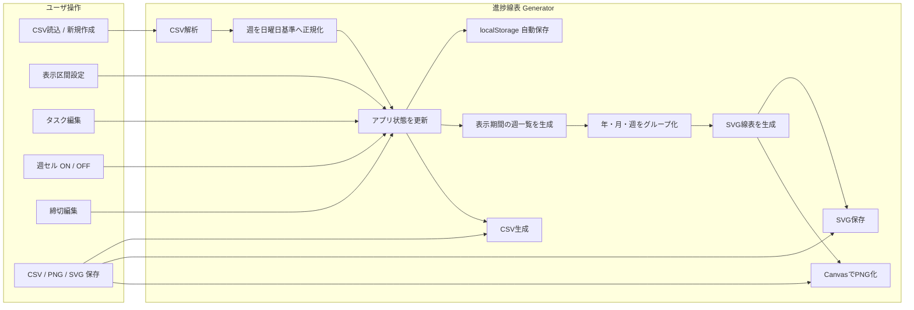

<div id="top"></div>

# 進捗線表 Generator

進捗線表 Generator は，研究・開発などの進捗予定を週単位の色ブロックで可視化し，CSV による編集データの入出力と，PNG / SVG による線表画像の保存を行う Web アプリケーションである．

線表は「年 → 月 → 週」の 3 段ヘッダで構成し，1 列を日曜日始まりの 1 週間として扱う．タスクの実施期間は矢印ではなく週セル内の色ブロックで表現する．開始週・終了週による連続範囲の指定に加えて，各週セルを直接 ON / OFF できるため，同一タスクに対して離れた複数週を設定することもできる．  
編集内容はブラウザの `localStorage` に自動保存し，正式な保存・バックアップには CSV を利用する．

---

## 使用技術一覧

<p style="display: inline">
  
  
  
  
  
  
  
  
</p>

---

## 目次

- [プロジェクトについて](#プロジェクトについて)
- [ファイル構成](#ファイル構成)
- [利用ライブラリ](#利用ライブラリ)
- [線表の基本仕様](#線表の基本仕様)
- [画面構成](#画面構成)
- [タスク管理](#タスク管理)
- [締切管理](#締切管理)
- [線表プレビュー](#線表プレビュー)
- [日付・週の扱い](#日付週の扱い)
- [CSV形式](#csv形式)
- [保存データ](#保存データ)
- [PNG・SVG出力](#pngsvg出力)
- [データフロー](#データフロー)
- [使用方法](#使用方法)
- [注意点](#注意点)

---

## プロジェクトについて

進捗線表 Generator は，研究計画や開発スケジュールを週単位で整理し，MTG 資料や Word 文書などへ貼り付けやすい線表を生成するための Web アプリケーションである．

本アプリでは，タスクごとに以下を管理する．

- 進捗状態
- 大区分
- タスク名
- 実施週
- 表示色
- 表示順序

線表の横軸は週単位で固定し，各週の実施有無を色ブロックとして表示する．開始週と終了週を設定すると連続した週を一括選択できるほか，プレビュー上の週セルを直接操作することで非連続な週も設定できる．

また，締切はタスクとは別に日付単位で登録し，線表上へ縦線とラベルとして表示する．

サーバやデータベースは使用せず，すべての処理をブラウザ内で完結する．

<p align="right">(<a href="#top">トップへ戻る</a>)</p>

---

## ファイル構成

```text
.
├── index.html
├── style.css
├── app.js
└── README.md
```

各ファイルの役割は以下である．

| ファイル | 内容 |
|---|---|
| `index.html` | 画面構成，入力フォーム，タスク編集表，線表プレビュー領域 |
| `style.css` | WebApp 全体のデザイン，編集表，レスポンシブ表示 |
| `app.js` | 状態管理，週計算，CSV 入出力，SVG 描画，PNG / SVG 保存，`localStorage` 保存 |
| `README.md` | 本ドキュメント |

「サンプルCSV保存」を押すと，内蔵のサンプルから `sample_schedule.csv` を生成する．

<p align="right">(<a href="#top">トップへ戻る</a>)</p>

---

## 利用ライブラリ

本アプリは外部 JavaScript ライブラリを使用しない．

以下のブラウザ標準機能を利用する．

- File API
  - CSV ファイルの読み込みに使用する．
- `localStorage`
  - 編集中データの自動保存に使用する．
- `Blob` / `URL.createObjectURL()`
  - CSV，SVG，PNG のダウンロードに使用する．
- SVG
  - 線表本体をベクター形式で描画する．
- Canvas API
  - SVG を PNG に変換する際に使用する．

外部 CDN を読み込まないため，基本機能はオフライン環境でも利用できる．

<p align="right">(<a href="#top">トップへ戻る</a>)</p>

---

## 線表の基本仕様

### ヘッダ構成

線表の横軸は，以下の 3 段で表示する．

```text
年     │                 2026 年
月     │         8 月                   │        9 月
週     │ 8/2~ │ 8/9~ │ 8/16~ │ 8/23~ │ 8/30~ │ 9/6~ │ ...
```

各列は 1 週間を表し，週は必ず日曜日から開始する．

週ラベルは以下の形式で表示する．

```text
8/9~
8/16~
8/23~
```

たとえば `8/9~` は，2026 年 8 月 9 日（日）から 8 月 15 日（土）までの週を表す．

### タスクの表示

タスク期間は矢印ではなく，週ごとの色ブロックで表示する．

```text
             8/9~   8/16~   8/23~   8/30~
環境評価実験   ■       ■       ■
原稿執筆                       ■       ■
```

タスクの進捗単位は常に 1 週間であり，1 週間の途中だけを部分的に塗る表現は使用しない．

表示区間内に選択された週が 1 件も存在しないタスクは，タスク管理データとしては保持したまま，線表プレビューおよび PNG / SVG 出力では表示しない．表示期間を変更し，そのタスクの選択週が表示区間へ入ると再び表示する．

### 月をまたぐ週

月をまたぐ週は，**その週の日曜日が属する月**へ配置する．

たとえば，

```text
2026/8/30 ～ 2026/9/5
```

は 8 月の週として扱う．したがって，8 月と 9 月の表示は次のようになる．

```text
8 月：8/2~ │ 8/9~ │ 8/16~ │ 8/23~ │ 8/30~
9 月：9/6~ │ 9/13~ │ 9/20~ │ 9/27~
```

<p align="right">(<a href="#top">トップへ戻る</a>)</p>

---

## 画面構成

### 1．データ

CSV の読み込みと保存を行う．

配置する主な操作は以下である．

- CSVを読み込む
- 新規作成
- CSV保存
- サンプルCSV保存

CSV を読み込むと，各線表のタイトル，表示期間，週行，週セル幅の設定と，共通のタスク，進捗状態，選択週，色，締切を復元する．

### 2．表示設定

以下を設定する．

- 線表タイトル
- 表示開始週
- 表示終了週

表示開始週と表示終了週には，日曜日の日付のみを選択肢として表示する．

「＋ 線表追加」を押すと，その線表のタイトル，表示期間，週行，週セル幅の設定を複製する．タスクと締切はすべての線表で共有する．「この線表を削除」で表示設定を削除できる．

### 3．タスク管理

タスクの追加・編集・削除・並べ替えを行う．

### 4．線表プレビュー

現在の設定を基に線表を生成する．  
プレビュー内の各週セルは直接操作できる．

各線表に週行の切り替えと以下の保存ボタンを配置する．

- PNG保存
- SVG保存

「すべてオン」「すべてオフ」で，すべての線表の週行を一括で切り替える．

<p align="right">(<a href="#top">トップへ戻る</a>)</p>

---

## タスク管理

「＋ タスク追加」を押すと，新しいタスクを追加する．

各タスクでは以下を編集する．

| 項目 | 内容 |
|---|---|
| 進捗 | 未着手・実行中・完了を切り替えるチェックボックス |
| 大区分 | タスクをまとめるカテゴリ名 |
| タスク名 | 線表左側に表示する名称 |
| 開始週 | 連続期間として塗る最初の週 |
| 終了週 | 連続期間として塗る最後の週 |
| 色 | タスクブロックの表示色 |
| 選択週 | 現在選択されている週数 |
| 順序 | 「⠿」をドラッグしてタスク行を移動 |
| 削除 | タスクを削除 |

左端のチェックボックスを押すたびに，空白（未着手）→ −（実行中）→ ✓（完了）→ 空白（未着手）の順に切り替える．キーボードでは `Space` キーで操作できる．

### 開始週・終了週

開始週と終了週を設定すると，両端を含む連続した週を自動的に選択する．

たとえば，

```text
開始週：2026/8/9～
終了週：2026/8/23～
```

の場合，以下の 3 週を選択する．

```text
2026-08-09
2026-08-16
2026-08-23
```

### 非連続な週の設定

プレビュー上の週セルをクリックすると，その週だけ選択状態を切り替える．

そのため，以下のような非連続な設定も可能である．

```text
実験解析：2026-07-26，2026-09-13
```

なお，開始週または終了週を後から変更すると，その範囲を基に選択週を連続状態へ作り直す．非連続な設定を行う場合は，開始週・終了週を設定した後にプレビュー上で調整する．

<p align="right">(<a href="#top">トップへ戻る</a>)</p>

---

## 締切管理

タスクとは別に，日付単位の締切を登録できる．

「＋ 締切追加」を押すと締切行を追加する．

各締切では以下を設定する．

| 項目 | 内容 |
|---|---|
| 締切名 | 線表下部へ表示する締切名 |
| 日付 | 締切日 |
| 色 | 縦線およびラベル枠の色 |
| メモ | 補足表示 |
| 削除 | 締切を削除 |

表示期間内に存在する締切のみを線表へ表示する．

たとえば，

```text
IMWUT 提出締切
2026-11-01
提出：11月1日
```

を登録すると，11 月 1 日の位置に縦線を表示し，線表下部に締切名とメモを表示する．

<p align="right">(<a href="#top">トップへ戻る</a>)</p>

---

## 線表プレビュー

線表本体は SVG として生成する．

プレビューには以下を表示する．

- 線表タイトル
- 年
- 月
- 週
- 大区分
- タスク名
- 週単位の色ブロック
- 締切線
- 締切ラベル

週セルはクリック操作に加えて，キーボードの `Enter` または `Space` でも ON / OFF を切り替えられる．

また，Word などへ貼り付けた際に全体が過度に縮小されないよう，左側の大区分・タスク名列および週セルは，表示文字列を収められる範囲で可能な限りコンパクトに構成する．

週行をオンにした線表は，表示期間が長い場合に横スクロールできる．週行をオフにすると，週の日付ラベルを省き，薄い線で週を，少し濃い線で月を区切る．どちらの表示でも週セルを操作できる．

週行オフの初期設定では，線表がプレビューの横幅いっぱいになるように週セル幅を調整する．週セル幅のスライダーを動かすと，その線表の幅を手動で設定できる．画面幅を超える場合は横スクロールで確認する．「幅を合わせる」を押すと，ウィンドウの大きさに連動する自動調整に戻る．見出しなどの文字が入りきらない場合は短縮または省略する．

<p align="right">(<a href="#top">トップへ戻る</a>)</p>

---

## 日付・週の扱い

### タスク

タスクの週データは，必ずその週の日曜日の日付で保持する．

```text
2026-08-09
2026-08-16
2026-08-23
```

CSV 読み込み時に日曜日以外の日付が指定されていた場合は，その日を含む週の日曜日へ自動補正する．

例：

```text
2026-08-12 → 2026-08-09
```

補正が発生した場合は，WebApp 上へ補正件数を表示する．

### 締切

締切は週へ丸めず，指定した日付をそのまま保持する．  
線表上では表示開始週の日曜日からの日数差を用いて，週セル内の正確な日付位置へ縦線を描画する．

<p align="right">(<a href="#top">トップへ戻る</a>)</p>

---

## CSV形式

CSV のヘッダは以下である．

```csv
record_type,order,category,name,start_week,end_week,weeks,date,color,note,status,show_week_row,week_cell_width
```

`record_type` により，設定，タスク，締切を 1 ファイル内で管理する．

### settings

線表ごとに 1 行ずつ，タイトル，表示区間，週行と週セル幅の設定を保存する．

```csv
settings,,,◎線表,2026-07-05,2027-03-28,,,,,,1,
```

| 列 | 内容 |
|---|---|
| `record_type` | `settings` |
| `name` | 線表タイトル |
| `start_week` | 表示開始週 |
| `end_week` | 表示終了週 |
| `show_week_row` | 週行を表示する場合は `1`，隠す場合は `0`．旧形式では表示する |
| `week_cell_width` | 週行オフで手動設定した週セル幅（px）．空欄または旧形式では自動調整 |

### task

タスク情報を保存する．

```csv
task,3,研究,解析,2026-07-26,2026-09-13,2026-07-26;2026-09-13,,#4f7ec7,,running,,
```

| 列 | 内容 |
|---|---|
| `record_type` | `task` |
| `order` | タスク表示順 |
| `category` | 大区分 |
| `name` | タスク名 |
| `start_week` | 選択週の最小値 |
| `end_week` | 選択週の最大値 |
| `weeks` | 実際に着色する週 |
| `color` | ブロック色 |
| `status` | `not_started`（未着手），`running`（実行中），`completed`（完了） |

`status` 列がない旧形式の CSV や，値が空欄のタスクは未着手として読み込む．

`weeks` には実際に選択されている週を `;` 区切りで保存する．

```text
2026-07-26;2026-09-13
```

したがって，`start_week` と `end_week` の間に未選択の週が存在する場合でも，非連続なタスク期間を保持できる．

CSV 読み込み時は `weeks` を優先する．  
`weeks` が空の場合は，`start_week` から `end_week` までを連続した週として復元する．

また，互換用として `start_date` / `end_date` が存在する CSV も読み込み可能であり，それぞれ該当週の日曜日へ補正して使用する．

### deadline

締切情報を保存する．

```csv
deadline,1,,提出締切,,,,2026-11-01,#3f78c5,提出：11月1日,,,
```

| 列 | 内容 |
|---|---|
| `record_type` | `deadline` |
| `order` | 締切順 |
| `name` | 締切名 |
| `date` | 締切日 |
| `color` | 縦線およびラベル色 |
| `note` | 補足メモ |

CSV 保存時には UTF-8 BOM を付与し，日本語を含む CSV を表計算ソフトで開いた際の文字化けを抑える．

<p align="right">(<a href="#top">トップへ戻る</a>)</p>

---

## 保存データ

編集状態は，操作のたびにブラウザの `localStorage` へ自動保存する．

保存対象は以下である．

- 各線表のタイトル，表示開始週，表示終了週，週行の表示設定，週セル幅
- タスク一覧
- タスクの進捗状態
- 大区分
- タスク名
- 選択週
- タスク色
- タスク順序
- 締切一覧
- 締切日
- 締切色
- 締切メモ

`localStorage` は同じブラウザで作業を継続するための一時的な保存先として利用する．

ブラウザデータを削除した場合や，別の PC・別ブラウザを使用した場合は復元できないため，正式な保存・バックアップには CSV を利用する．

「新規作成」を押した場合は，現在の編集状態を新規線表へ置き換える．必要なデータは事前に CSV 保存する．

<p align="right">(<a href="#top">トップへ戻る</a>)</p>

---

## PNG・SVG出力

### SVG保存

各線表に表示している SVG を，週行の設定と横幅を含めて保存する．

SVG はベクター形式であるため，Word，PowerPoint，Illustrator などで拡大しても文字や罫線がぼやけにくい．

### PNG保存

生成した SVG を Canvas へ描画し，PNG として保存する．  
PNG は内部的に 2 倍解像度で生成する．

### ファイル名

CSV のファイル名には先頭の線表のタイトルを使用する．SVG と PNG のファイル名には保存対象の線表のタイトルを使用する．

たとえば線表タイトルが，

```text
◎卒業研究線表
```

の場合，先頭の `◎` を除き，以下のようなファイル名で保存する．

```text
卒業研究線表.csv
卒業研究線表.svg
卒業研究線表.png
```

ファイル名に使用できない文字 `\\ / : * ? " < > |` は `_` に置き換える．

<p align="right">(<a href="#top">トップへ戻る</a>)</p>

---

## データフロー



<p align="right">(<a href="#top">トップへ戻る</a>)</p>

---

## 使用方法

### 1．WebAppを開く

以下のファイルを同じフォルダへ配置する．

```text
index.html
style.css
app.js
```

`index.html` をブラウザで開く．  
本アプリは外部ファイルを `fetch()` しないため，ローカルサーバを起動せずに利用できる．

保存済みのデータがない場合は，関連研究調査，デバイス実装と実験，解析，執筆の 4 件を表示する．

GitHub Pages などの静的ホスティングへ配置して利用することもできる．

### 2．新しい線表を作成する

「新規作成」を押す．  
既存の編集内容がある場合は確認ダイアログを表示する．

### 3．表示区間を設定する

「表示開始週」と「表示終了週」を選択する．  
選択肢はすべて日曜日始まりである．

### 4．タスクを追加する

「＋ タスク追加」を押す．

追加後，以下を入力する．

- 大区分
- タスク名
- 開始週
- 終了週
- 色

必要に応じて，順序列の「⠿」をドラッグして表示順を変更する．

### 5．週単位で調整する

線表プレビュー内の週セルをクリックし，その週の実施有無を切り替える．

連続範囲だけでなく，離れた週を同じタスクへ設定できる．

### 6．締切を追加する

必要な場合は「＋ 締切追加」を押し，締切名，日付，色，メモを設定する．

### 7．線表を確認する

プレビュー上で，年，月，週，大区分，タスク，色ブロック，締切が正しく表示されていることを確認する．

表示区間内に選択週がないタスクはプレビューへ表示しない．

### 8．CSVを保存する

「CSV保存」を押す．  
編集内容を再度読み込める CSV ファイルとして保存する．

### 9．PNG / SVGを保存する

用途に応じて以下を利用する．

- PNG保存
  - MTG 資料，画像共有などに利用する．
- SVG保存
  - Word，PowerPoint，Illustrator などで高品質に利用する．

<p align="right">(<a href="#top">トップへ戻る</a>)</p>

---

## 注意点

* タスクの進捗単位は週であり，1 日単位のタスク期間は設定しない．
* 週は日曜日始まりで扱う．
* 月をまたぐ週は，その週の日曜日が属する月へ表示する．
* CSV の `weeks` に日曜日以外の日付が指定された場合は，読み込み時に該当週の日曜日へ補正する．
* 締切は週単位へ補正せず，指定した日付をそのまま使用する．
* 開始週・終了週を変更すると，その範囲を連続した選択週として再設定する．非連続な週を利用する場合は，開始週・終了週を設定した後にプレビュー上で調整する．
* 表示区間外にしか実施週がないタスクは，データとして保持されるが線表プレビューには表示しない．
* PNG / SVG はプレビューで設定した週セル幅で出力する．週行オフの自動調整では，プレビュー領域と同じ横幅で出力する．
* `localStorage` はブラウザ単位の保存であり，バックアップ用途には使用しない．正式な保存には CSV を利用する．
* ブラウザのプライベートモードや設定によっては，`localStorage` のデータが保持されない場合がある．
* CSV ファイルを表計算ソフトで直接編集する場合，`weeks` の複数週は `;` 区切りを維持する．
* `color` は `#RRGGBB` 形式で指定する．
* PNG はラスター画像，SVG はベクター画像である．Word や PowerPoint へ貼り付けて拡大する場合は SVG を推奨する．

<p align="right">(<a href="#top">トップへ戻る</a>)</p>
